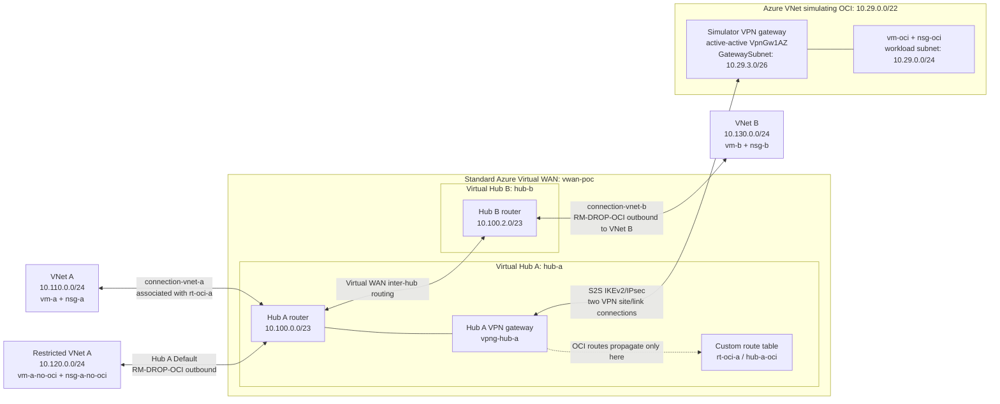

# vWAN-to-OCI PoC architecture

## Purpose and scope

The PoC demonstrates an Azure Virtual WAN with two hubs: VNet A can communicate with a simulated OCI network in both directions, while `vnet-a-no-oci` on Hub A and VNet B on Hub B are restricted from that network. The simulator is an **Azure VNet**, not an OCI tenancy.

The deployed lab is in resource group `rg-vwan-oci-5387083d` in East US 2. Both virtual hubs are in the same region; this is not a multi-region resiliency test.

The restricted Hub A VNet was deployed and verified on 2026-11-18. The three existing VMs were replaced with the owner's approval to reconcile OS disk SKU drift.

## Logical topology



Plain-text view:

```text
                  Standard Virtual WAN
VNet A / vm-a --- hub-a ===== hub-b ---[outbound map]--- VNet B / vm-b
                    |
          [outbound map] --- VNet A no OCI / vm-a-no-oci
                    |
             Hub A VPN gateway
                    |
               S2S IPsec
                    |
          Azure simulator / vm-oci
```

Hub A and Hub B are **virtual hubs inside the same Virtual WAN**, not separate customer sites. The simulator connects directly to Hub A's vWAN VPN gateway over S2S IPsec. It is not connected through VNet peering or a VNet-to-hub connection.

## Components and address plan

| Component | Address space | Role |
|---|---|---|
| `vwan-poc` / `hub-a` | `10.100.0.0/23` | Hub A and its VPN gateway terminate the simulator connection. |
| `vwan-poc` / `hub-b` | `10.100.2.0/23` | Hub B connects the restricted VNet B. |
| `vnet-a` / `vm-a` | `10.110.0.0/24` | Approved test workload, connected by `connection-vnet-a`. |
| `vnet-a-no-oci` / `vm-a-no-oci` | `10.120.0.0/24` | Restricted Hub A workload, connected by `connection-vnet-a-no-oci`. |
| `vnet-b` / `vm-b` | `10.130.0.0/24` | Restricted test workload, connected by `connection-vnet-b`. |
| `vnet-oci` / `vm-oci` | `10.29.0.0/22`; workload subnet `10.29.0.0/24` | Azure-hosted simulator of the remote OCI workload. |
| Simulator `GatewaySubnet` | `10.29.3.0/26` | Hosts the simulator's Azure VPN gateway. |

Each workload subnet has an NSG. The four Linux test VMs have private IPs only, SSH on TCP 22, and a test HTTP listener on TCP 30289. Azure VM Run Command is used to initiate tests without exposing the VMs publicly.

## VPN and routing

Hub A's `vpng-hub-a` is the Virtual WAN VPN gateway. The simulator uses an active-active Azure VPN Gateway, `vng-oci-simulator`, with two public IP configurations. The lab has two vWAN VPN sites (`site-oci-primary` and `site-oci-secondary`), their corresponding vWAN connections, and two simulator-side local network gateways and connections. The two site/link connections were connected during the recorded test; this does not establish failover behavior.

The VPN configuration is static and BGP is disabled:

- Each VPN site identifies the simulator address space, `10.29.0.0/22`.
- Each simulator-side local network gateway identifies VNet A, `10.110.0.0/24`, as an Azure destination. Neither restricted VNet prefix is included.
- Both sides use IKEv2 with AES256, SHA384, and ECP384 for IKE; IPsec uses GCMAES256 and ECP384 PFS with a 3600-second SA lifetime.
- Both Hub A VPN connections remain associated with Hub A's Default route table, but propagate the simulator prefix to the Hub A-only `rt-oci-a` route table with label `hub-a-oci`. Hub B has no route table with this label, so the OCI prefix is not propagated to Hub B's Default table.
- VNet A is associated with `rt-oci-a` so it receives the simulator route. VNet A's prefix also propagates to Hub A's Default route table, preserving the return path from the VPN branch.
- The restricted Hub A connection associates with Hub A Default and propagates its own prefix only to `rt-oci-a`, not the VPN-associated Default table. This makes its prefix available to approved VNet A without advertising it through Hub A Default to the VPN connection.

### Route propagation and route-map safeguard

The primary isolation mechanism is propagation scoping: the VPN connections send the simulator route only to a route table labeled `hub-a-oci` in Hub A. No Hub B route table has that label, and the simulator prefix should therefore be absent from Hub B's Default table.

Each hub has its own `RM-DROP-OCI`, associated **outbound on the restricted VNet connection** (`connection-vnet-a-no-oci` or `connection-vnet-b`), meaning it processes advertisements toward that VNet:

| Setting | Value |
|---|---|
| Match | Route prefix `Contains` `10.29.0.0/22` |
| Action | `Drop` |
| Next step | `Terminate` |

The match covers the specified prefix and more-specific prefixes, not broader aggregates. Unmatched routes are allowed by default. VNet A does not have this drop map. The map acts on routes advertised to the entire connected VNet, not on individual subnets, and **is not a packet firewall**. Review broader and alternate routes separately.

The map is defense in depth: it prevents a matching route from being advertised to VNet B if it enters Hub B through another path. The earlier configuration allowed Hub B's Default table to learn the simulator prefix from the remote hub; the scoped propagation update is intended to stop that route at the hub-to-hub boundary. This PoC does not test a route map attached to the VPN connection itself.

## Traffic paths and safeguards

| Traffic | Intended path or control | Expected test result |
|---|---|---|
| VM A to simulator | VNet A's `rt-oci-a` -> Hub A VPN gateway -> simulator VPN gateway -> simulator workload. | Connect on TCP 22 and 30289. |
| Simulator to VM A | Simulator gateway uses its static VNet A destination -> Hub A VPN gateway -> VNet A connection. | Connect on TCP 22 and 30289. |
| VM A no OCI to simulator | Hub A Default omits the simulator route; the outbound map and NSGs add safeguards. | Block on TCP 22 and 30289. |
| Simulator to VM A no OCI | Simulator static destinations omit the restricted VNet; NSGs deny both directions. | Block on TCP 22 and 30289. |
| VM B to simulator | Hub B does not learn the simulator route; the outbound map and B/simulator NSGs remain defense in depth. | Block on TCP 22 and 30289. |
| Simulator to VM B | Simulator static destinations omit VNet B; simulator and B NSGs independently deny traffic between their prefixes. | Block on TCP 22 and 30289. |

The restricted VNet and simulator NSGs explicitly deny traffic between their prefixes in both directions for all protocols. The NSGs on A and the simulator allow the approved peer on TCP 22 and 30289 and deny other sources on those test ports. The route maps, NSGs, and simulator static routes are separate controls; a timeout alone does not identify which control blocked a packet. Permitted workloads could proxy traffic unless separately restricted. VNet-to-VNet connectivity is outside the OCI acceptance scope.

## Observed results

On 2026-11-17 before the route-propagation update, the lab passed all eight TCP checks across the four directions and two ports. Before the map was associated, VM B had an active `10.29.0.0/22` route via `VirtualNetworkGateway`; after association it had no active matching route. VM A retained that route, while Hub B's Default route table still retained the prefix via `Remote Hub`.

The NSG denies and A-only simulator static routes were active before and after the map, so the traffic tests do not prove that the route map **alone** enforced isolation. The subsequent propagation update was verified separately on 2026-11-18; see the [recorded evidence summary](../vWAN-RouteMap-PoC-Backlog.md#scoped-route-propagation-verification-2026-11-18).

The four-VM recheck on 2026-11-18 passed all 12 TCP checks and eight local-listener checks. Hub A's custom table contained the simulator and restricted VNet prefixes, while Hub A Default contained neither; Hub B Default had no simulator route. The restricted VMs' most-specific covering NIC route was `10.0.0.0/8` with next hop `None`. Azure returned empty connection-level effective-route lists even for approved VNet A, so the route conclusions use the hub tables and NIC effective routes instead. See the [verification record](../vWAN-RouteMap-PoC-Backlog.md#restricted-hub-a-verification-2026-11-18) and [test runbook](testing-vwan-oci-poc.md).

## Boundaries and operations

- The simulator does not reproduce an OCI DRG, OCI Network Firewall, or real OCI routing. It uses two Azure VPN sites and an active-active simulator gateway, unlike the customer's single-CPE, Instance0-only arrangement. Neither that arrangement nor failover has been validated.
- The lab is deployed using Azure Developer CLI and Terraform. The source definitions are in [`infra/main.tf`](../infra/main.tf), [`infra/vpn.tf`](../infra/vpn.tf), and [`infra/network.tf`](../infra/network.tf).
- Do not commit the VPN pre-shared key or Terraform state. The local state and saved plans contain the key and require access-controlled, encrypted storage; evidence also contains network details. See the [deployment instructions](../README.md#configure).
- Hubs, VPN gateways, public IPs, and VMs incur ongoing charges. Delete the lab only with the owner's explicit approval.

## References

- [Azure VPN Gateway to Virtual WAN](https://learn.microsoft.com/en-us/azure/virtual-wan/connect-virtual-network-gateway-vwan)
- [About Virtual WAN route maps](https://learn.microsoft.com/en-us/azure/virtual-wan/route-maps-about)
- [Configure Virtual WAN route maps](https://learn.microsoft.com/en-us/azure/virtual-wan/route-maps-how-to)
- [About Virtual WAN hub routing](https://learn.microsoft.com/en-us/azure/virtual-wan/about-virtual-hub-routing)
